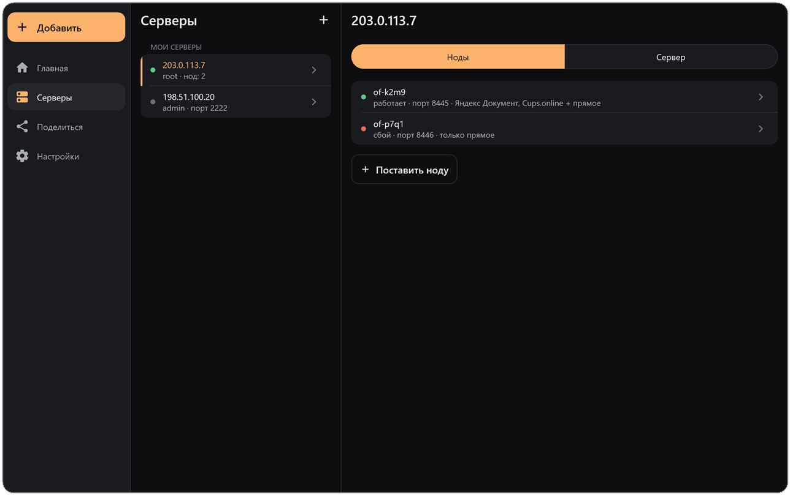

<p align="center">
  
</p>

<h1 align="center">OpenFluxClientShared</h1>

<p align="center">
  The interface and logic shared by the OpenFlux apps for Android, Windows, macOS and Linux.
</p>

<p align="center">
  <a href="LICENSE"></a>
  
</p>

<p align="center">
  <a href="https://github.com/p1neappleXpress/OpenFlux">Core</a> · <a href="https://github.com/p1neappleXpress/OpenFluxDesktop">Desktop</a> · <a href="https://github.com/p1neappleXpress/OpenFluxAndroid">Android</a> · <a href="https://testflight.apple.com/join/BwnAcdus">iOS (TestFlight; the App Store release is coming)</a>
</p>

<p align="center">
  
</p>

<p align="center">
  
</p>

The Compose Multiplatform UI and business logic shared by
[OpenFluxAndroid](https://github.com/p1neappleXpress/OpenFluxAndroid) and
[OpenFluxDesktop](https://github.com/p1neappleXpress/OpenFluxDesktop): profile
and session models, the connection screens, the node-deployment wizard, and
the service interfaces each platform implements (core process/IPC, the
built-in browser, settings storage).

This repository has no build of its own — it's meant to be used as a git
submodule at `shared/` from a consumer project that already has its own
Gradle root (wrapper, version catalog, `:androidApp`/`:desktopApp` modules),
matching the source-set layout below:

```
src/
  commonMain/      Models (Profile, CoreConfig, ConnectionState, NodeWizard),
                    service interfaces, the design system, and the screens -
                    shared across every platform
  jvmSharedMain/    Code both desktop and Android use (java.io, java.util.zip)
  androidMain/      Android-only implementations
  jvmMain/
    core/           Core process launch, IPC status, Yandex checks (desktop)
    node/           This platform's own node wizard (core --node-wizard over
                     stdin/stdout)
    web/            The built-in browser: off-screen KCEF, a proxy router,
                     a log
    platform/       Windows system proxy (WinInet), admin rights
    data/           Settings and profile storage
```

## Navigation

The app has four places, each with its own stack of screens (`ui/nav`):

| Place | What it is for | Screens |
|---|---|---|
| Главная | connect, disconnect, state | the connect screen; the account, the journal and the ways to connect open on top of it |
| Подключения | everything one connects *with* | the list (subscription, own nodes, the rest) → a profile → its fields; add a connection; the OpenFlux account and signing in |
| Ноды | what one *runs* | the list → a node → change it on its server (profile, SSH access and the channel's transports and mode on one screen); the wizards that make a node (own server, PHP hosting) |
| Настройки | how the app behaves | categories (connection, accounts of Yandex and Mail.ru, core, interface, experimental, about and updates); the journal; the transport catalogue |

`AppNav` keeps the place and a stack per place. A detail screen opens on top of
the place the person is in, so "back" returns to where they came from; a tap on
a place's tab shows where they left it, a second tap its first screen; back from
a place's first screen goes Home. `AppActions` names every move ("add a
connection", "manage the node", "make a node"), so screens call it instead of
knowing where things live, and `AppActions` lets go of what a screen held (a
wizard's SSH session) when the navigation drops it. In a wide window the lists
of Connections and Nodes stay at the left and a profile's or node's screen opens
beside them.

## Origin and credit

This module's code, architecture, and design come from
[meepo161/OpenFluxClient](https://github.com/meepo161/OpenFluxClient), used
here with the author's agreement. Full commit history and authorship are
preserved as extracted from that repository. **Huge thanks to
[@meepo161](https://github.com/meepo161)** for building it.

It talks to the [OpenFlux](https://github.com/p1neappleXpress/OpenFlux) core
(the tunnel/transports/protocol) through the service interfaces in
`commonMain`, implemented per platform in the consuming app.

## License

GNU General Public License v3.0 or later — see [LICENSE](LICENSE). The
original repository this was extracted from carried no explicit license;
adopting the core project's GPL-3.0 here keeps licensing consistent across
the OpenFlux ecosystem, with the author's agreement.
